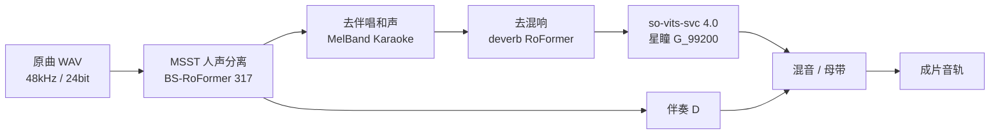

# 星瞳音色 AI 翻唱《你的记忆》

> 用 **so-vits-svc 4.0 + 星瞳音色权重**，把《女神异闻录3》片尾曲「キミの記憶」做成 AI 翻唱，并配套一套 P3 平涂风格的 MV 视觉方案。
> 本仓库记录**完整流程、实测参数、提示词与踩坑**；模型权重、工具链、中间音频不上传。


---

## 这是什么

一个从零跑通的 **AI 翻唱流水线**：人声分离 → 音色转换 → 混音 → 视觉素材。全部本地运行，不依赖付费在线服务。

选它当样本，是因为这条链上的坑很典型：分离模型的版本搭配、torch 与 torchaudio 的版本配对、旧版 so-vits 分支消失、AI 重绘「有结构的留白」不可控 —— 每一项都能单独卡死项目。

**目标曲目**：2006 原版，5:57.70，48kHz/24bit（P3R 版 6:39 未使用）
**目标音色**：星瞳 so-vits 4.0 权重 `G_99200`（第三方训练，非商用）

## 完成度

| 环节 | 产物 | 状态 |
|---|---|---|
| 人声分离 | A/B/C/D 四条分轨，44.1kHz 立体声 32bit float | ✅ A+D 与原曲逐采样互补，相关系数 **1.00000000** |
| 音色转换 | 20 秒样片 + 全曲 3 版（`-cr` 0.5/0.6/0.7） | ✅ 最平衡一版 `-cr 0.6` |
| 主视觉 | 蓝版 2048×1152 / 红版 1920×1080 | ⚠️ 蓝版成立，红版背景有缺陷 |
| 字幕 | 能量包络切句脚本（未接 SRT） | ⏳ 切点可用 |
| MV 动画 | 哩布试验提示词包 + 本地 ComfyUI 方案 | ⏳ 仅方案，未出图 |
| 混音成片 | — | ⏳ 未做 |

## 试听

| 文件 | 内容 | 规格 |
|---|---|---|
| [`E_换声样片_副歌20秒_星瞳.wav`](assets/E_换声样片_副歌20秒_星瞳.wav) | 副歌 20 秒换声样片 | 20.0 s / 44.1kHz / mono |
| [`C2_0key_xingtong20_0.6.wav`](assets/C2_0key_xingtong20_0.6.wav) | 全曲换声，`-cr 0.6`（推荐版本） | 5:57.7 / 44.1kHz / mono |

> 点击文件名可在线播放或下载。全曲版是**纯人声干轨**，需要叠加伴奏（见下方流程）。

## 流程



三连分离是**串联**的，不能拿整首歌直接进「去混响」：

```
① 人声模型   → 主唱 + 和声 + 混响（A 轨）
② 和声模型   → 剥掉伴唱，留主唱（B 轨，换声主力素材）
③ 去混响模型 → 干声（C 轨，要自己加混响时用）
```

## 关键实测数据

| 指标 | 数值 |
|---|---|
| 分离 GPU / CPU 加速比 | **19.4×**（30 秒片段：44.32 s vs 861.75 s） |
| 三连分离全曲耗时 | **约 11 分 30 秒**（6:07 + 2:54 + 2:26） |
| 换声速度（CPU） | 20 秒音频推理 6.04 s，约 **3.3× 实时**，全曲 2–3 分钟 |
| 有主唱时长占比 | **54.4%**，其余静音段会被切片器自动跳过 |
| 换声输出响度偏移 | 比输入响约 **+5 dB**（−17.55 → −12.12 dBFS），混音时要压回来 |
| 交付电平 | 统一规范化到 **−1.0 dBFS**（原始输出峰值会过冲到 +0.12 dBFS） |

## 快速复现

依赖不随仓库分发，按 [`docs/星瞳翻唱项目总记录.md`](docs/星瞳翻唱项目总记录.md) 第 3、4 章重建。

```bat
# 1) 分离：MSST-GUI（Python 3.13 + torch 2.11.0+cu126）
#    模型放 pretrain/，配置放 configs/，三连推理
#    人声: model_bs_roformer_ep_317_sdr_12.9755.ckpt
#    和声: mel_band_roformer_karaoke_aufr33_viperx_sdr_10.1956.ckpt
#    去混响: deverb_bs_roformer_8_256dim_8depth.ckpt

# 2) 换声：so-vits-svc 4.0（Python 3.10 + torch 2.0.1 CPU）
.venv\Scripts\python.exe inference_main.py ^
  -m logs/xingtong20/G_99200.pth ^
  -c configs/xingtong20.json ^
  -n input_name -t 0 -s xingtong20 ^
  -cm logs/xingtong20/cluster/kmeans_10000.pt -cr 0.6 ^
  -sd -50 -wf wav

# 3) 混音：人声压 ~5 dB 对齐伴奏 → 导出 −1.0 dBFS
```

**版本必须严格配对，错了必崩**

```
MSST   : Python 3.13 + torch 2.11.0+cu126 + torchaudio 2.11.0+cu126
so-vits: Python 3.10 + torch 2.0.1        + torchaudio 2.0.2
```

## 参数速查

| 参数 | 值 | 说明 |
|---|---|---|
| `-t` | `0` | 变调半音，女声转女声用 0 |
| `-s` | `xingtong20` | 必须与 config 的 `spk` 键一致，填中文会报错 |
| `-cr` | `0.5`–`0.7` | 聚类占比。越高越像，越高越容易不稳；**0.6 最平衡** |
| `-sd` | `-50` | 静音切片阈值。−50 保留呼吸气口，−40 更激进 |
| `-wf` | `wav` | 默认是 flac |

**常见症状处方**

| 症状 | 调整 |
|---|---|
| 齿音、气声丢太多 | `-sd` 改 −55 / −60 |
| 音色不够像 | `-cr` 提到 0.6–0.7，监听有无金属感 |
| 高音破音、发飘 | `-cr` 降到 0.3，或该段单独 `-t -1` |

## 六个坑（每一个都能卡死一天）

1. **不要整体 `pip install -r requirements.txt`** —— AI 项目的 requirements 常年混着训练依赖（sageattention / bitsandbytes / wxpython），推理只要十几项。
2. **torch 与 torchaudio 必须成对** —— PyPI 上 torchaudio 2.0.1 硬依赖 torch 2.0.0，正确配对是 torch 2.0.1 + torchaudio 2.0.2。
3. **so-vits-svc 只能 4.0，不能 4.1** —— 4.1 编码器锁死 768 维，这套权重是 256 维。原仓库已无 4.0 分支，要用 `justinjohn0306` 的 fork。
4. **不要开 `-a/--auto_predict_f0`** —— 代码里是 `type=bool`，传任何非空字符串都变 `True`，歌声开自动预测会严重跑调。
5. **Windows 的 .bat 里不能写中文** —— cmd 按代码页逐字节解析，`chcp 65001` 也救不了。中文逻辑全部交给 Python。
6. **CUDA 版 torch 下不动就先用 CPU** —— 下载 2.6 GB 要 5 小时，而 sovits CPU 3.3× 实时已够用。

完整 13 条见文档第 3.7、4.5 节。

## MV 视觉

主视觉走「P3 平涂 + 丝网印刷」路线，配色靠后期而不是靠模型。

```
persona 3, soejima shigenori, official art,
flat color, cel shading, limited palette, three tone shading, high contrast,
silkscreen print, risograph, poster art,
cyan, cobalt blue, monochrome blue,
underwater, water surface, bubbles, coral silhouette, negative space
```

红版（镜像构图）在生成模型上迭代 8 轮仍未达标，结论是**别继续抽卡**：

```
① 纯背景图整体色相旋转（10 秒，质感 100% 保留）
② 人物从纯白底抠图
③ 图层合成，右下角保留浅暖粉收口
```

三条可复用的教训：

- **氛围词会劫持质感** ——「雾一样的通透」直接把平滑渐变变成烟雾水彩；想控质感只能写反向约束 + 给参照图。
- **「留白」在中文里等于「别画」** —— 想要有颜色的空，得写「渐变的天幕」「每个角落都有颜色」。
- **两轮不对就换手动合成** —— 生成模型在「有结构的留白」上不可控，合成出来的结果反而更准。

完整提示词（通用版 / 豆包专用版 / 留白校准 / 质感锁定 / 双区域分步）见文档第 6 章。

## 目录结构

```
.
├── README.md
├── docs/
│   └── 星瞳翻唱项目总记录.md      # 完整存档：环境、参数、13 个坑、全部提示词、歌词
└── assets/
    ├── 蓝色星瞳.png               # 主视觉 2048×1152（可用）
    ├── 红色星瞳.png               # 镜像红版 1920×1080（背景有缺陷）
    ├── E_换声样片_副歌20秒_星瞳.wav
    ├── C2_0key_xingtong20_0.6.wav # 全曲换声 5:57.7
    └── 你的记忆歌词.docx           # 日 / 中对照
```

**仓库里没有**：模型权重（`G_99200.pth` 518 MB、kmeans、hubert 181 MB）、工具链（约 9 GB 环境）、四轨分离 WAV（约 1 GB）、音频生成脚本。这些都能按文档重装或十几分钟重算。

> 当前最大单文件 31 MB，在 GitHub 100 MB 限制内；若后续加入更多音频，建议启用 Git LFS。

## 使用边界

- 星瞳为腾讯虚拟偶像，声线归属真人声优。本项目为**个人非商用二创**；商业使用需另行授权。
- so-vits 权重作者要求：转换音频**禁止商用**，个人二创请标注「一闪一闪小星瞳」与项目地址。
- 曲目与角色版权归 **ATLUS / SEGA** 所有。
- 仓库内音频、图像均为二次创作产物，**不适用 MIT 等宽松许可**；如需引用请先联系，不要直接商用或二次分发。
- 若 fork 后要正式发布，请自行补一份与实际素材相符的 LICENSE —— 当前内容不适合挂 MIT。

## 致谢

- [so-vits-svc 4.0](https://github.com/justinjohn0306/so-vits-svc-4.0)（`justinjohn0306` fork，唯一保留 `f0_decoder` 的 4.0 分支）
- [MSST-WebUI](https://github.com/Sucial/MSST-WebUI) / MSST GUI v1.4（by 领航员未鸟）
- 星瞳 so-vits 4.0 权重：B站专栏 `814460614067879959`
- 模型下载：Hugging Face `Sucial/MSST-WebUI`（国内可用 `hf-mirror.com`）

## 更新日志

- **2026-11-16** 归档：合并 6 份零散笔记为单份总记录，清理 10.8 GB 工具链与中间文件
- **2026-11-13** 完成分离、全曲换声、主视觉；字幕切句脚本
